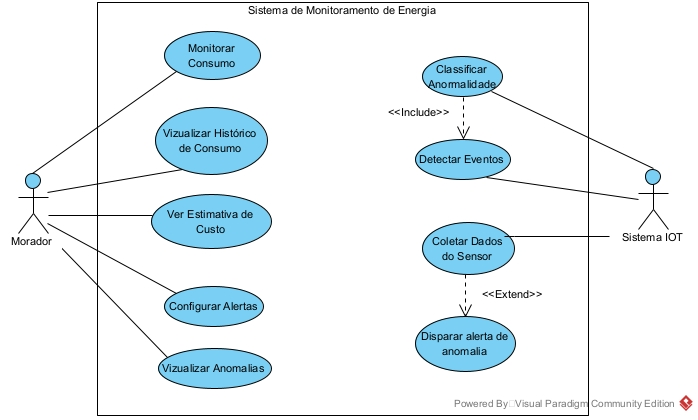

# PI - Sistema Inteligente Para Monitoramento De Energia Elétrica

Este projeto é um sistema de Internet das Coisas (IoT) voltado ao monitoramento residencial de consumo de energia elétrica em tempo real, integrado a um aplicativo mobile com painel de acompanhamento, previsão de fatura e alertas de consumo elevado.

Desenvolvido por **André Oliveira Paim**, **Bruno Aparecido Vivencio Rodrigues** e **Igor Nogueira Pessoa** (FATEC ZL - 2ª ADS AMS).

## Problema

Este projeto visa preencher a lacuna de **soluções residenciais de baixo custo** que integrem, de forma nativa:

* Monitoramento em tempo real via IoT
* Cálculo dinâmico da fatura conforme a realidade tributária nacional
* Suporte às **bandeiras tarifárias da ANEEL**

A proposta está alinhada ao **ODS 7** da ONU (energia acessível e limpa), especificamente à meta 7.3 de melhoria da eficiência energética.

## Funcionalidades

* Leitura em tempo real da corrente elétrica da residência
* Cálculo e exibição do consumo instantâneo em watts (W)
* Acúmulo diário e mensal de consumo em quilowatts-hora (kWh)
* Estimativa da fatura com base na tarifa vigente e bandeira tarifária ativa
* Alertas configuráveis de consumo elevado
* Painel (dashboard) com gráficos e histórico de consumo

### Diagrama de Casos de Uso

## Arquitetura

O sistema será organizado em três camadas:

**Camada de Hardware**
O microcontrolador ESP32 coleta os dados de corrente elétrica através do sensor SCT-013 e transmite os valores ao Firebase via Wi-Fi em intervalos regulares.

**Camada de Dados**
O Firebase Realtime Database armazena os registros, provendo autenticação de usuário via Firebase Authentication e sincronização automática com o aplicativo.

**Camada de Apresentação**
O aplicativo mobile consome os dados do Firebase em tempo real e os exibe ao usuário por meio de dashboards, gráficos e alertas.

## Tecnologias Utilizadas

### Hardware
* ESP32 DevKit - Microcontrolador com Wi-Fi e Bluetooth integrados 
* SCT-013 - Sensor de corrente não invasivo
* Fonte 5V - Alimentação dedicada do dispositivo 

### Software
* Arduino IDE / C++ - Firmware do ESP32
* EmonLib - Cálculo de corrente eficaz a partir do sinal analógico
* Firebase Realtime Database - Banco de dados em nuvem com sincronização em tempo real
* Firebase Authentication - Autenticação de usuários
* React Native - Framework do aplicativo mobile (Android)

## Resultados Esperados

Ao fim do desenvolvimento, espera-se entregar um **protótipo funcional** para medição e acompanhamento do consumo de energia elétrica residencial, com potencial de escalabilidade. Está sendo avaliada ainda a viabilidade de implementação de um **modelo de Inteligência Artificial** para otimizar a análise dos resultados de consumo e a geração de dashboards.
